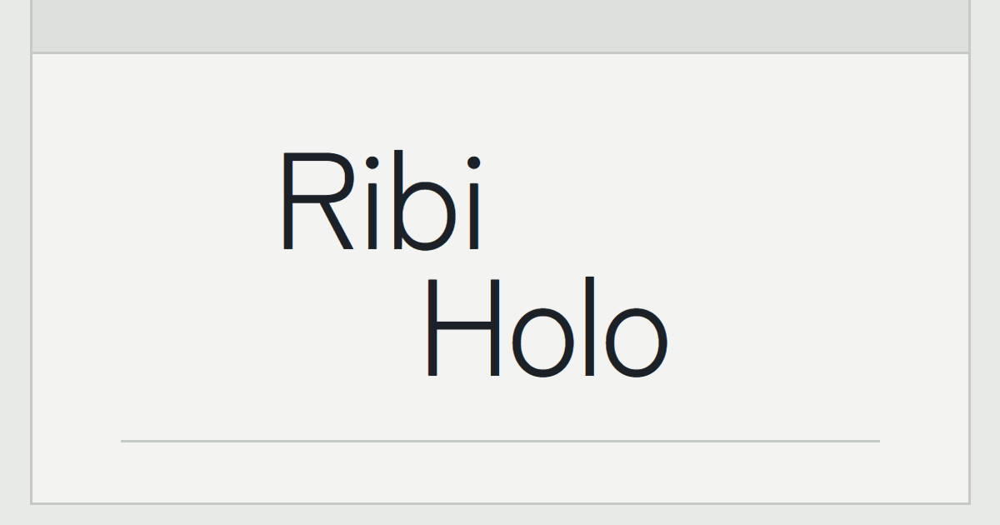

# Ribi Holo

Link web: [Ribi Holo](https://ribi-holo.pages.dev/)

- `css/pokemon-cards-css/cards/` and `css/pokemon-cards-151/cards/` — the card stylesheets of simeydotme's two projects, unchanged except that texture paths (`/img/...`, CDN links) now point to `img/foils/`.
- `js/` — `holo-card.js` and `spring.js` port the card interaction of both projects (Card.svelte + svelte/motion spring) to plain JS; `app.js` is the interface.
- `Card Reference.zip` — the reference images behind the "Download reference" link.
- `img/card*.webp` — the default card, mask, foil and back.

Uploaded images stay in the browser and disappear when the tab is closed.

You can use local with index.html

Licenses: the card CSS and the interaction logic derive from [simeydotme/pokemon-cards-css](https://github.com/simeydotme/pokemon-cards-css) and [simeydotme/pokemon-cards-151](https://github.com/simeydotme/pokemon-cards-151) (GPL-3.0); see `licenses/`.

